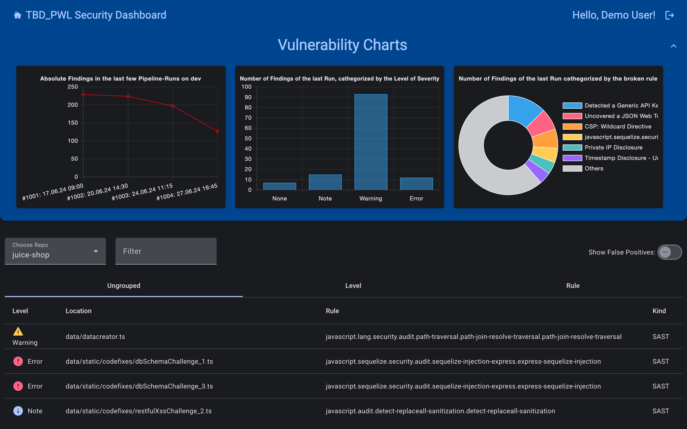
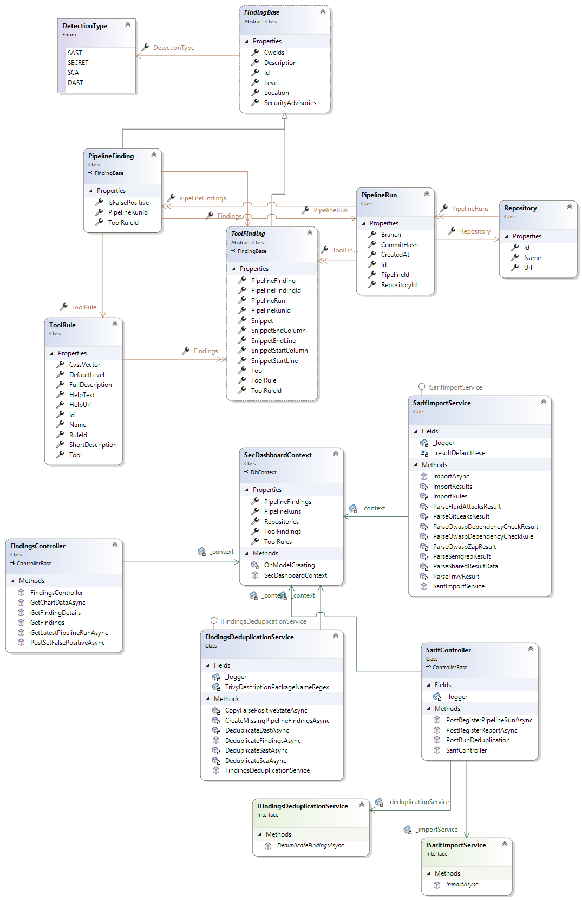

# Security Dashboard (Backend)

The API behind the Security Dashboard. CI pipelines upload SARIF reports from their security scanners, and the API imports, deduplicates and stores the findings, then serves them to the dashboard.

Built as a six-person team project for the courses *Agile Entwicklungsmethoden* (agile development methods) and *IT-Sicherheit* (IT security) at TH Aschaffenburg (summer semester 2024). The Angular frontend lives in [security-dashboard](https://github.com/la-w/security-dashboard).



## Features

- **SARIF import** for Fluid Attacks (SAST/DAST), Semgrep, Gitleaks, OWASP Dependency-Check, Trivy and OWASP ZAP, each mapped to its own finding type.
- **Deduplication** of findings within a pipeline run.
- **Two ways to authenticate:**
  - CI pipelines upload with an API key, and only from allowlisted IPs.
  - Dashboard users authenticate with GitLab OIDC (JWT bearer tokens).
- **Read endpoints** for the latest pipeline run, finding details, chart data and false-positive marking.
- Swagger UI in Development, structured logging with Serilog.

## Tech stack

ASP.NET Core 8, Entity Framework Core with SQLite, Microsoft SARIF SDK, Serilog, Swashbuckle, Docker, GitLab CI. Tests use xUnit and NSubstitute.



## My contributions

My code was on the frontend (findings list, detail view and table). On the backend I reviewed and merged teammates' merge requests.

Team: Benjamin Langer, Dominik Orgis, Louis Graßmann, Pascal Schmidt, Tobias Reinhard, Wutthichai Laphutama.

## Running locally

The `demo` branch adds a `DemoMode` setting, used only in Development, that opens the read endpoints, because the original GitLab OIDC provider is no longer reachable. Uploads still need the API key.

```bash
cd SecurityDashboard-Backend
dotnet run --launch-profile http              # http://localhost:5090/swagger
# With only a newer .NET SDK installed:
# DOTNET_ROLL_FORWARD=Major dotnet run --launch-profile http

# In a second terminal: upload the sample SARIF reports as four pipeline runs
./demo/seed-demo-data.sh

dotnet test                                    # run the test suite
```

The original GitLab CI pipeline (`.gitlab-ci.yml`) targeted the university's infrastructure and is kept for reference only.
